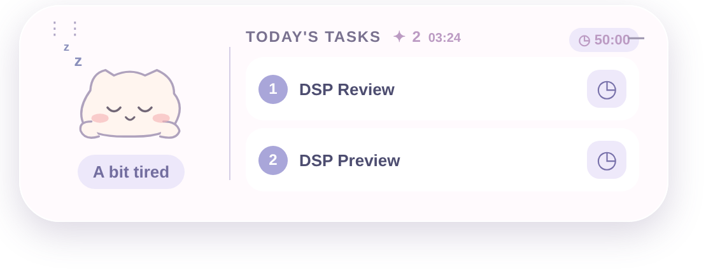
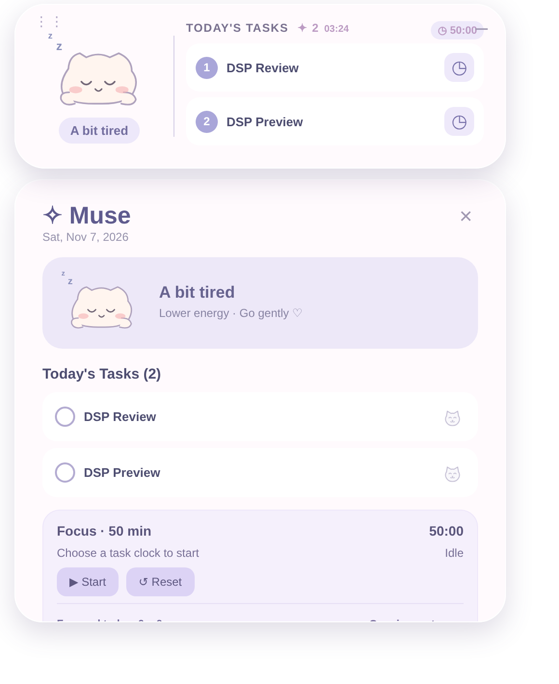

# Muse Desktop 🐱

**A gentle desktop companion for one thing at a time.**

Muse is a lightweight Windows desktop pet that displays your two chosen daily tasks, a small focus timer, and a doodle cat reflecting a mood that you explicitly share. It is designed to stay calm and unobtrusive.





> **Development release candidate (v0.5.4).** The project includes Windows installer and portable-build automation, but no binary has been built or signed in this repository snapshot. The screenshot is a browser preview of the same widget interface, not proof of an installed Windows EXE.

## Features

- Tiny pastel doodle cat with **Focused / Calm / A bit tired / Low energy / Stressed** states.
- **Today's Tasks:** select up to two from a connected Notion Tasks data source.
- Move a task **Back to All Tasks** by pressing the small cat icon; it never deletes or edits the Notion page.
- A **50-minute focus timer** per chosen task: start, pause, resume, reset, and locally recorded session time.
- Optional collapsible session goal, check-in, and review notes.
- Current time in the mini widget; expanded panel for the full controls.
- Notion task and mood **read-only** sync, plus a manual **Sync now** control.
- First-run connection setup in **Settings**, with Notion token encrypted locally using Windows-backed safe storage.

## Get the Windows app

Build status: [Windows installers](https://github.com/yl14982-cloud/muse-desktop/actions/workflows/windows-build.yml). Each push to `main`, version tag, or manual run validates the source and builds unsigned x64 installer and portable executables.

Read **[Windows installation guide](docs/INSTALL-WINDOWS.md)** for two methods:

1. Build an unsigned Windows installer and portable `.exe` using the **Actions → Build Windows installers → Run workflow** button; then download the workflow artifact.
2. Build on Windows by double-clicking `Build-Windows.cmd` (or using `npm.cmd run dist:win`).

The installer build is configured to create a **Desktop** and **Start Menu** shortcut. After installation, no PowerShell is needed for normal startup.

## Developer setup

Requires Node.js LTS and a supported Windows environment:

```powershell
npm.cmd ci --foreground-scripts --ignore-scripts=false
npm.cmd test
npm.cmd run check
npm.cmd start
```

To package:

```powershell
npm.cmd run dist:win
```

## Notion setup

Create a read-only integration in Notion and grant it access to your own **Tasks data source** and **Muse State page**. Open **Muse → Settings** and provide your integration token, tasks data source ID, and state page ID. Click **Save & sync**.

**You do not need to save a token in project files or paste it into a PowerShell window for the packaged app.**

Imported task names are shown verbatim. Muse does not automatically translate your personal Notion content into English.

### How conversation-driven mood syncing works

ChatGPT can update a mood entry in Notion **when explicitly triggered in a conversation with authorized access**. Muse then reads that entry on its next sync, approximately every 90 seconds. Muse does **not** automatically watch every ChatGPT message or infer mood continuously.

## Security & privacy

Read [Privacy and data](docs/PRIVACY.md). Never put an API token in a commit, screenshot, issue, or chat. If exposed, rotate it. The application only needs **read** access to your Notion pages. Current `.gitignore` excludes build artifacts and user data; do not commit real secrets.

## Known limitations

- Windows installer/portable output is unsigned and still needs a real Windows build + end-to-end test.
- This version does not automatically choose tasks for today or update Notion task completion.
- Existing developer-install data migration has not been validated.
- The five mood drawings are static. Four-frame animation is only a design idea, not an implemented feature.
- Auto-start with Windows is not yet included.

## Roadmap

- Signed public releases and automated update strategy
- Desktop-window polish and optional always-on-top setting
- Optional focus-session export and improved mood animation
- Windows installer user acceptance tests

## License

**License not selected.** The code can be viewed, but no open-source reuse permission is granted by default. Choose a license before accepting external contributions or promising open-source rights.
